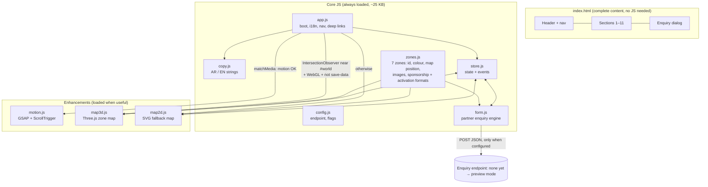
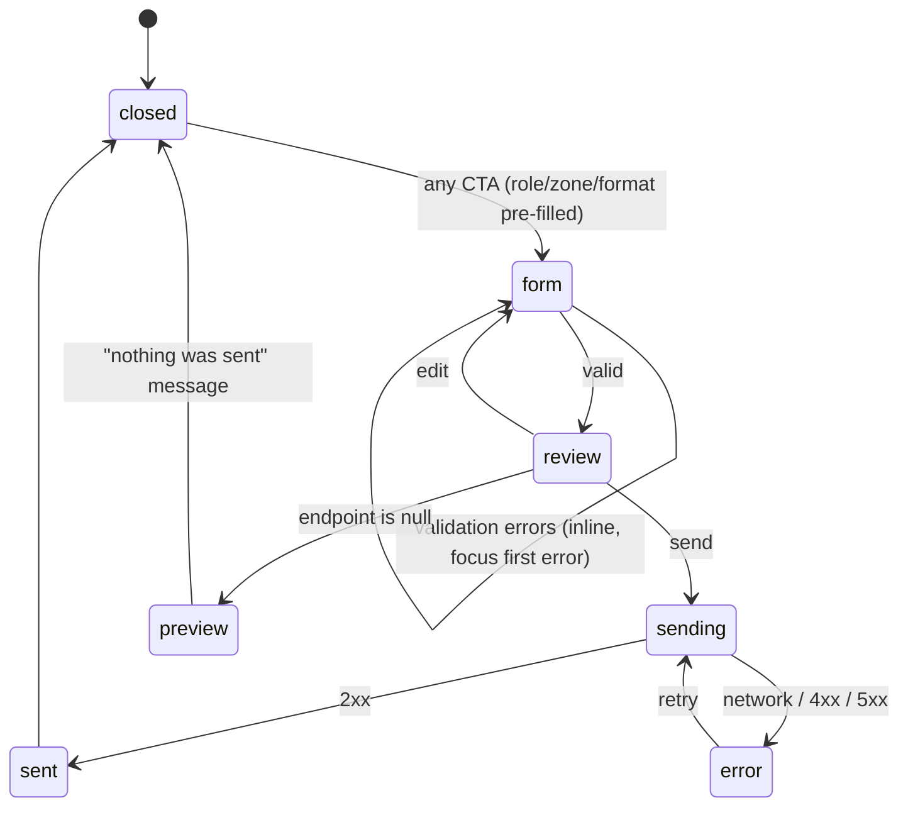

# PinkOut Partners — System design

> **v3 (three partner types).** Additions to the sections below:
> - **State:** new key `partnerType: "event" | "beauty" | "shop" | null`, set by doors, track CTAs, the map's track filter and `?apply=beauty` deep links. `interest`, `format` and `theme` apply to the event branch only.
> - **Data:** `tracks.js` holds the three tracks (id, anchor, deck id, services or categories lists, requirements, steps). `zones.js` gains `tracks: ["event", "beauty"]` per zone, so the map can highlight where each type lives (Beauty Lab → event + beauty; Pink Market → event + shop).
> - **Payload:** `{ partnerType, ...shared, ...branch }`, where:
>   - *shared* = `name, email, phone, message, wantsDeck, lang, consent, source`
>   - *event* = `interest, goals[], zones[], themes[], timing, company, jobTitle`
>   - *beauty* = `applyingAs: "freelancer"|"salon", services[], where: "event"|"home"|"both", experience, license: "yes"|"in-progress", portfolio, businessName`
>   - *shop* = `brand, categories[], where: "event"|"app"|"both", storeLink, productCount`
> - **Decks:** `config.decks = { event: null, beauty: null, shop: null }`. The deck checkbox records the request; sending stays off until an endpoint exists (preview mode).
> - **Deep links:** `#event`, `#beauty`, `#shop`, `?apply=event|beauty|shop`, `#world/beauty-lab?track=beauty`.


## 1. Principles

1. **Progressive enhancement in layers.** HTML alone is a complete, readable site. CSS makes it beautiful. JS adds behaviour. GSAP adds motion. Three.js adds the 3D map. Each layer can fail without breaking the one below.
2. **One source of truth per thing.** Copy lives in `copy.js`; zone data in `zones.js`; UI state in `store.js`. The 3D map, the 2D fallback, the zone panel and the form all *read* the same state.
3. **Plain stack.** HTML + CSS + vanilla ES modules, no build step. GSAP and Three.js vendored at pinned versions.
4. **English-first, Arabic-ready.** `lang="en" dir="ltr"` by default, full RTL on switch; every horizontal motion value is multiplied by the direction sign; no text inside WebGL.

## 2. Architecture



## 3. State (`store.js`)

A ~40-line store: `get`, `set`, `on(key, fn)`. No framework.

| Key | Type | Set by | Read by |
|---|---|---|---|
| `lang` | `"en" \| "ar"` (default `en`) | language toggle, `?lang=`, remembered locally | everything with text, motion (direction rebuild) |
| `zone` | zone id \| `null` | 3D map, 2D map, zone list buttons, `#world/<zone>` hash | map highlight, zone panel, camera, form pre-fill |
| `interest` | `"sponsorship" \| "activation" \| "unsure"` | Opportunities cards, CTAs | form pre-fill |
| `format` | format id \| `null` | Opportunity cards | form pre-fill |
| `theme` | theme id \| `null` | "Sponsor a themed day" | form pre-fill |
| `motion` | `"full" \| "reduced"` | OS setting + footer toggle | motion.js, map3d.js |
| `dialog` | `"closed" \| "form" \| "review" \| "sent" \| "error"` | form.js | dialog UI |

**Deep links:** `/#world/beauty-lab` opens the map on that zone; `/#opportunities/stage-sponsor` scrolls to that format; `/?enquire=sponsorship` opens the form; `/?lang=ar` opens in Arabic. The sales team can send these links to a specific partner ("here's the Beauty Lab view").

## 4. Data model

```js
// zones.js — one record per zone (copy comes from copy.js by key)
{
  id: "beauty-lab",
  order: 4,
  colour: { a: "#C7B7E8", b: "#ddcffb" },   // direction A / B companion colour
  map: { x: 3.2, z: -1.4, size: 2.2, shape: "arch" }, // illustrative layout units
  image: "assets/images/worlds/beauty",      // -480/-960/-1600.webp
  copy: "world4",                            // → World 4 name/heading/text/tag
  sponsorship: ["zone-sponsor"],
  activations: ["trials", "personalisation", "boutique", "launch"]
}
```

```js
// config.js — figures stay null until the client supplies them from the partner deck;
// a null figure renders nothing on the live site (no fake numbers ever ship)
proof: [
  { id: "research-1", value: null, label: "…", source: "…", date: "…" },
  { id: "social",     value: null, label: "…", source: "…", date: "…" }
],
enquiryEndpoint: null,          // null = preview mode
consumerSite: "https://pinkoutsa.com"
```

```js
// Enquiry payload (form.js → endpoint)
{
  interest: "sponsorship" | "activation" | "unsure",
  zones: ["beauty-lab", "pinkout-live"],
  themes: ["kpop-night"],
  timing: "opening-season" | "later" | "exploring",
  company: "…", name: "…", jobTitle: "…", email: "…", phone: "…" /* optional */,
  message: "…", wantsDeck: true, lang: "en", consent: true,
  source: "hero" | "zone-map" | "opportunities" | "themes" | "closing" | "header"
}
```

## 5. Enquiry form engine (`form.js`)



- `config.enquiryEndpoint = null` keeps today's honest **preview mode**. Setting a URL turns sending on with no other code change.
- Spam: honeypot field + minimum fill time. No CAPTCHA.
- Nothing is stored locally except an unsent draft (`sessionStorage`, guarded).

## 6. 3D zone map (`map3d.js`)

| Topic | Decision |
|---|---|
| Model | **Procedural**, built from code (no GLB download): an ivory floor disc, Rose Hub in the centre, six zones in a ring, Pink Passage at the "entrance" edge. Each zone is a simple volume with the PinkOut **arch** motif in its companion colour. About 7 meshes plus instancing for details. |
| Camera | Isometric-feel perspective, limited orbit (±25°), no free zoom. Selecting a zone → GSAP tweens the camera and target to frame it. |
| Picking | Raycaster on pointer. **The real controls are HTML buttons** (a list of 7 zones beside the canvas), so keyboard and screen-reader users drive the same state. |
| Labels | HTML overlay elements positioned from 3D coordinates each frame, never text inside WebGL (Arabic shaping). |
| Rendering | **Render on demand**: only while tweening, hovering or auto-idle drift; stops otherwise. Pauses when off-screen or the tab is hidden. DPR capped at 2 (1.5 on touch). |
| Loading | `import()` only when `#world` is within one viewport of view, and WebGL is available, and Save-Data is off. A poster image shows until the first frame. |
| Fallback | `map2d.js`: an SVG top-down map using the same zone positions and the same buttons and panel. Used for no WebGL, Save-Data, very low-end devices and print. With reduced motion, 3D is still allowed but static: no drift, and camera moves are instant. |
| Cleanup | `dispose()` geometries, materials and renderer on language rebuild or page hide. |

## 7. Motion (`motion.js`)

- Everything inside `gsap.matchMedia()` → `(prefers-reduced-motion: no-preference)` and the footer motion toggle.
- Long sequences use **native CSS `position: sticky` shells** plus scrubbed timelines (not `pin: true`). This continues the current site's fix for Back-button and restore bugs.
- `ScrollTrigger.refresh()` after fonts load, on `pageshow` (back/forward cache), and on language change (direction flips).
- Only `transform`, `opacity` and `clip-path` are animated.

## 8. File structure

```
index.html  privacy.html  credits.html  404.html  robots.txt  sitemap.xml   (no consumer pages)
assets/
  css/   tokens.css (direction A or B)  base.css  layout.css  components.css  map.css  motion.css
  js/    config.js copy.js zones.js store.js app.js form.js motion.js map3d.js map2d.js
  js/vendor/  gsap.min.js  ScrollTrigger.min.js  three.module.min.js  (+ LICENSE files)
  images/ worlds/ themes/ app/ patterns/ logo*.svg   (copied from SWSH, only what's used)
  video/  hero desktop + mobile, 9 wall loops       (copied from SWSH, only what's used)
  fonts/  Alexandria or IBM Plex Sans Arabic (subset woff2, depends on direction)
docs/    brief.md content.md system-design.md ux.md wireframe.md design-system.md motion-notes.md QA.md
deploy/  nginx.conf (reused)
```

## 9. Performance budget (mobile, first load)

| Item | Budget |
|---|---|
| HTML + critical CSS | ≤ 60 KB gz |
| Core JS | ≤ 30 KB gz |
| GSAP + ScrollTrigger | ~45 KB gz (deferred) |
| Three.js + map | ~170 KB gz, **lazy**: not part of first load |
| Hero poster (LCP) | ≤ 90 KB WebP, preloaded |
| Fonts | ≤ 3 files, subset, `font-display: swap` |
| Target | Lighthouse mobile ≥ 85 (today: 85), LCP ≤ 3.5 s, CLS < 0.05 |

## 10. Deploy

The same as today: static files on nginx with `deploy/nginx.conf` (gzip, HTTP/2, year-long cache for `?v=N` files, no-cache HTML, HTTPS redirect, private `.md`). Bump `?v=N` on every changed asset.
