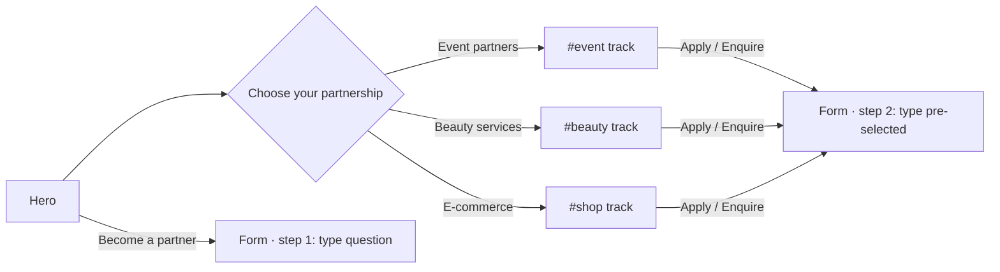
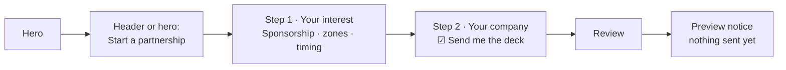
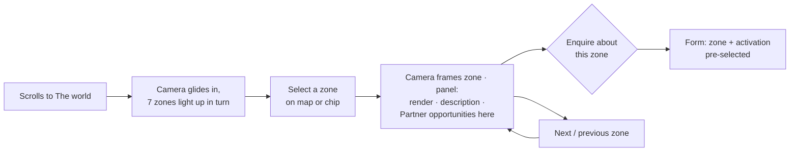

# PinkOut Partners — User experience (v3: three partner tracks)

> **v3:** the site now serves three partner types. Sections 1–2 below (Faisal, Noura, agency; flows A–E) describe the **Event track**. This v3 block adds the beauty and e-commerce tracks and the shared entry.

## v3.1 New personas

| Persona | Situation | Goal | Biggest worry | What wins her over |
|---|---|---|---|---|
| **Reem, freelance makeup artist** (Riyadh) | Sees a PinkOut post on Instagram; opens the link on her iPhone | "Can I work there, at events and with home clients?" | "Is it only for big salons? Will it take forever to apply?" | "Freelancers welcome" up front, clear requirements (license + portfolio), a 2-minute application where she pastes her Instagram |
| **Hessa, salon owner** | A friend forwards the link on WhatsApp | "Could my team cover event stations and home bookings?" | "What do they take, and how does home booking work?" | Honest "home bookings when the app launches", terms in the deck, salon option in the form |
| **Lama, small accessories brand founder** | Finds it via the consumer site's footer or Instagram | "Can I sell at the event, and later in the app?" | "Do my products fit? Is there a big setup cost?" | Category chips she recognises, event-first then app, terms in the deck, a quick seller application |

## v3.2 Shared entry: the three doors

- The header nav lists the three tracks first, so a returning partner can jump straight to her track.
- On phones, the sticky bar's main button follows the visible track ("Apply as beauty partner" while in `#beauty`).

## v3.2b Feeling special: personal links

The partnerships team shares a link per audience: `/?for=beauty` in artist DMs, `/?for=shop` to sellers, `/?for=event` to sponsors.

The link:
- greets the partner in the hero, in their track colour
- moves their door first, marked "Made for you"
- sets the sticky button and form to their type

Everything else stays visible, so a partner who is two types (e.g. a salon that also sells products) can still find the other track. The choice is remembered for the session only.

## v3.3 Beauty service flow (Reem, phone)

Door "Beauty services" → **Where you work** (At the event · At home, when the app launches) → services chips (she sees "Makeup") → **Requirements** checklist (license ✓, Instagram ✓) → **Apply as beauty partner** → form:
1. Freelancer
2. Services: Makeup, Lashes · Where: Both · License: Yes · Instagram link
3. Name, phone, email, ☑ beauty deck

→ Review → preview notice.

## v3.4 E-commerce flow (Lama, phone)

Door "E-commerce" → **Where you sell** (At the event: Pink Market · In the app, when it launches) → categories (Accessories ✓) → requirement → **Apply as seller** → form:
1. Categories: Accessories, Gifts · Where: Both · Instagram store link · 21–100 products
2. Brand name, name, email, ☑ e-commerce deck

→ Review → preview notice.

## v3.5 Form branching rules

- Step 1 (type) is skipped when the form opens from a track or door; the progress then reads "1 of 2", otherwise "1 of 3".
- Switching type keeps the shared fields (name, email, phone, message) and clears type-only fields after a confirmation.
- Required fields per type are listed in `content.md`. Errors are announced in the summary and inline.
- Link fields (portfolio, store) accept an Instagram @handle or a URL; we normalise both.
- The deck checkbox label names the type: "Send me the beauty partner deck".

## 1. Who we design for

| Persona | Situation | Goal on the site | Biggest worry | What wins her/him over |
|---|---|---|---|---|
| **Faisal, sponsorship lead** at a large Saudi brand (telco, bank, FMCG) | A colleague forwards the link by email; he opens it on a laptop between meetings and has 3 minutes. | "Is this worth a season or a zone sponsorship? Can I get the deck?" | "Is this real, or a pretty concept with no audience?" | Clear concept in one screen, honest status, audience figures with sources, a sponsorable asset list, deck on request in one form |
| **Noura, brand manager** (beauty / fashion / F&B) | Gets the link on WhatsApp; opens it on her iPhone, later on desktop. | "Where would our launch or product trial happen? What would it look like?" | "Will our brand look cheap or lost among others?" | The 3D map showing *her* zone, the premium look, concrete activation formats, enquiry pre-filled with her zone |
| **Agency account director** (on behalf of a client) | Building a proposal deck | Grab the facts, renders and the formats fast | Missing facts | Scannable sections, a deck request, deep links per zone to paste into the proposal |

**Design consequences**
- **Screen 1** says what PinkOut is, that it's for partners, and offers **Start a partnership**.
- **By scroll 3**, the visitor has seen the world (map) and its zones.
- **The audience proof** sits right after the map, before the opportunities: credibility before the ask.
- **The enquiry CTA** stays in the header at every scroll position.
- **There is no consumer content anywhere.** The footer has one quiet line, "Visiting PinkOut? pinkoutsa.com".

## 2. Primary flows

### Flow A: Fast path (Faisal, desktop)

### Flow B: Map path (Noura, the signature path)

### Flow C: Opportunity path

Opportunities → select **Stage sponsor** or **Product trials** → card shows its zone(s) → **Enquire** → form with interest, format and zone pre-filled.

### Flow D: Themed-day path

Themed days → **Sponsor a themed day** on a theme → form with interest = Sponsorship, theme = chosen.

### Flow E: Agency / share path

Zone panel and opportunity cards have **Copy link**. It copies a deep link like `/#world/beauty-lab`, which opens straight to that view, ready to paste into a proposal or a WhatsApp chat.

## 3. Navigation model

- **Header (sticky, compact on scroll):**
  - Desktop: Logo · The world · Opportunities · Audience · How it works · FAQ · **AR** · [**Partnership enquiry**]
  - Phone: Logo · [**Enquiry**] · ☰
- **Phone menu:** a full-screen sheet with the same links and the language switch.
- **Progress:** a thin line under the header; the active section is highlighted in the nav.
- **Deep links** for every section, zone, format and the form (see system design §3).

## 4. 3D map interaction

| | Desktop | Phone | Keyboard / screen reader |
|---|---|---|---|
| First view | The camera glides in, the zones light up one by one (≈2 s, skippable), then idle | Same, shorter | No motion; the list of 7 zone buttons is announced |
| Discover | Hover a zone: it lifts slightly and its label brightens | Zone chips under the map (horizontal scroll) | Tab to the zone list; arrow keys move in reading order (direction-aware) |
| Select | Click a zone or button | Tap a zone or chip → **bottom sheet** | Enter / Space |
| Panel | Side panel on the end side | Bottom sheet; swipe down / ✕ | Focus moves to the panel heading; Esc returns to the zone button |
| Panel content | Render · name · one line · **Sponsorship** row · **Activations** list · [Enquire about this zone] · Copy link | Same, stacked | Same |
| Orbit | Small drag (±25°) | Off: page scroll always wins | n/a |
| Reset | See all zones | Same | Same |

Always shown: *"Illustrative concept layout, not a final floor plan."*

## 5. Form UX

- **A dialog with 2 short steps + review**; progress shows "1 of 2". No long single page.
- **Pre-filled from the entry point** (interest, zone, format, theme), with every choice editable.
- **"Send me the partner deck" is checked by default.** This is the deck-on-request mechanism.
- **Business fields:** work email (gently warns on free-mail domains, never blocks), job title, phone with a +966 hint.
- **Validation:** inline on blur; on submit, focus goes to the first error, and an error summary is announced.
- **States:** the review screen, then (with no endpoint) "Enquiries open soon. This was a preview; nothing was sent." Once an endpoint exists: sending → sent (with what happens next) / error (data kept, retry).
- The language can switch mid-form without losing values; an accidental close keeps a session-only draft.

## 6. States to wireframe

- Hero with the film playing and paused
- Map: loading poster · ready · zone selected (desktop panel / phone sheet) · 2D fallback
- Audience: figures present · figures pending (placeholder slots, wireframe only)
- Form: step 1 · step 2 · errors · review · preview notice
- The whole page in Arabic (RTL)
- Reduced motion

## 7. Motion principles

- **Motion explains or impresses once.** The camera moves *to* the selected zone; the hero entrance plays once. Motion never delays reading.
- **Scroll-linked sequences** are short (≤ 1.5 viewports), reversible, and use native sticky (no pin spacers).
- **No endless bouncing or spinning.** The tone is premium, not toy-like.
- **Reduced motion or the motion toggle** gives final states instantly; the map still works, statically.

## 8. Accessibility & language

- **WCAG 2.2 AA:**
  - contrast (no white text on `#F17DBD`)
  - visible focus
  - 44 px targets
  - a real `<dialog>` with a focus trap
  - a skip link
  - a pause control for the film
- **English default.** Arabic switches `lang` and `dir` on `<html>`.
- **Logical CSS properties throughout.** Arrows and horizontal motion flip with direction.
- **Arabic words are never split for animation.**

## 9. Content rules (from the knowledge base)

Never state an opening date, an address, a final price, partner names, or any number that isn't from the deck with its source. Say **"women-first"**, **"coming soon to Riyadh"**, **"to be announced"**, **"illustrative concept"**.
